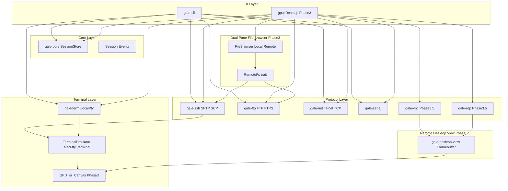

# GaleTerm 架构

## 分层



## Crate 职责

| Crate | 职责 |
|-------|------|
| `gale-core` | 会话模型、协议枚举、JSON 持久化（含 Ftp / Rdp / Vnc 配置）；可选 `RemoteFs` 领域类型 |
| `gale-term` | 本地 PTY；`TerminalEmulator` 封装 `alacritty_terminal`（网格、回滚）；`visible_styled_lines` 导出 RGB 段（16/256/truecolor） |
| `gale-ssh` | `russh` 封装：密码 / 公钥 / agent 认证、PTY/shell；known_hosts + TOFU；ProxyJump；端口转发；出站 HTTP/SOCKS5 代理；SFTP（`russh-sftp`）；SCP |
| `gale-ftp` | Phase 2/3：FTP / FTPS 客户端；实现 `RemoteFs`（LIST/RETR/STOR 等）；被动模式优先 |
| `gale-net` | Telnet（IAC 协商）与 Raw TCP 会话 |
| `gale-serial` | 跨平台串口（`tokio-serial`）：打开、列端口、stdio 中继 |
| `gale-vnc` | Phase 3.5：RFB/VNC 客户端（帧缓冲 + 输入）；可经 SSH 隧道拨号 |
| `gale-rdp` | Phase 3.5：RDP 客户端封装（倾向 IronRDP Apache-2.0）；输出帧交给桌面视图 |
| `gale-cli` | 可执行入口，验证核心链路 |
| `crates/gale-term-view` | Phase 3 终端 gpui Element：`StyledText` 段绘 fg/bg；后续 damage / 选中复制 |
| `crates/gale-desktop-view`（或桌面内模块） | Phase 3.5：远程桌面帧 / 键鼠 / 剪贴板，与 term-view 并列 |
| `apps/gale-desktop` | Phase 3 gpui + gpui-component；含 **双栏 FileBrowser**（本地 \| 远程） |

## 桌面 UI 分层（Phase 3）

| 层 | 内容 | 来源 |
|----|------|------|
| 1. gpui 内核 | `gpui-pre`，Cargo 里重命名为 `gpui` | 第三方，Apache-2.0 |
| 2. 通用组件 | Dock / Tabs / 分屏、Tree、虚拟化 Table / List、Input / Select / Form、Dialog / Notification / 右键菜单、主题、i18n、图标 | `gpui-component`，Apache-2.0 |
| 3. 终端视图 | 文本段合批绘制、光标 / 选区、damage 增量重绘、滚动、鼠标上报、IME、链接识别 | 自研 `gale-term-view` |
| 4. 业务组件 | `SessionTree`、`SettingsPage`、远程桌面会话页等 | 自研，位于 `apps/gale-desktop` |
| 4b. 双栏文件管理器 | **左本地 / 右远程**；路径栏、传输队列、拖拽上传下载；后端 `RemoteFs`（SFTP / FTP / FTPS） | 自研 `FileBrowser`，`apps/gale-desktop` |
| 5. 远程桌面视图（Phase 3.5） | VNC/RDP 帧缓冲绘制、键鼠、缩放/全屏、剪贴板 | 自研 `gale-desktop-view`；协议在 `gale-vnc` / `gale-rdp` |

约束：

- **gpui 依赖**：优先使用 meta crate **`gpui-kit = "0.10.0"`**（已捆绑 `gpui-component` + `gpui-pre =0.3.12` + macOS `font-kit`）。若直接依赖 gpui，必须与 component 精确同版本：
  ```toml
  gpui-kit = "0.10.0"
  # 或手动：
  # gpui = { package = "gpui-pre", version = "=0.3.12" }
  # gpui_platform = { package = "gpui-pre-platform", version = "=0.3.12", features = ["font-kit"] }
  ```
- **隔离 API 变动**：业务代码只调用第 4 层封装，不直接散用 `gpui-component`。
- **升级节奏**：`gpui-component` / `gpui-pre` 精确锁版本，`Cargo.lock` 入库，每月统一升级一次；CI 三平台编译。
- **退路**：`gpui-pre` 由个人发布，若停更则改为 git 依赖锁定 Zed 某个 commit（因第 1 层重命名，只改一行配置）。
- **许可**：终端视图只参考 `alacritty`（Apache-2.0）、`iced_term`（MIT）；Zed `terminal_view` 为 GPL，不可复制代码。
- **主题**：UI 主题沿用 `gpui-component` JSON 主题；终端配色（16 ANSI + 前景 / 背景 / 光标 / 选区）单独定义，同一份主题文件包含两部分；后续支持导入 iTerm2 / VS Code / WindTerm 配色。

## 数据流（SSH 会话）

1. UI / CLI 从 `SessionStore` 读取 `SessionProfile`
2. `gale-ssh` 建立 TCP + SSH 握手并认证
3. 打开 session channel，申请 PTY + shell
4. 远端输出 → 终端解析器 / 渲染；键盘输入 → channel data
5. 断线 / exit status → 会话状态机回收

## 桌面视觉与信息架构

详见 **[`docs/UI.md`](UI.md)**（基调 **Forge / 墨钢**、主窗口五段骨架、菜单规划）。

- 主题文件：`apps/gale-desktop/themes/gale-forge.json`
- 启动加载：`theme::apply_forge_theme`
- 壳层：Menu → Toolbar → Session Rail + Stage → Status Bar

## 国际化（i18n）

桌面端（`apps/gale-desktop`）使用 **rust-i18n** + gpui-kit 组件自带文案扩展：

| 项 | 说明 |
|----|------|
| 文案文件 | `apps/gale-desktop/locales/ui.yml`（`en` / `zh-CN`） |
| 组件文案 | `rust_i18n::extend!(gpui_component)`，应用层可覆盖 gpui-component 内置翻译 |
| 默认策略 | **跟随系统语言**（`sys-locale`）：`zh*` → `zh-CN`，其余 → `en` |
| 手动指定 | 侧栏「语言 / Language」：跟随系统 / English / 简体中文 |
| 持久化 | `ui-settings.json` 的 `locale`: `auto` \| `en` \| `zh_cn` |
| 切换 API | `gpui_kit::component::set_locale` + `cx.refresh_windows()` |

后续可加：`zh-TW` / 其它语言；设置页集中管理；CLI 帮助信息可选本地化。

## 配置位置

- 会话库：`$XDG_CONFIG_HOME/gale-term/sessions.json`（macOS: `~/Library/Application Support/gale-term/sessions.json`）
- UI 语言：同目录 `ui-settings.json`（`locale`: `auto` / `en` / `zh_cn`）
- 凭据：Phase 1 不落盘密码；Phase 3 起用系统钥匙串

## 设计约束

- `unsafe_code = forbid`（工作区 lint）；PTY/FFI 若必需则隔离到单独 crate 并审计
- 协议实现与 UI 解耦，保证同一套 `gale-ssh` / `gale-term` 可被 CLI 与 Desktop 复用
- 不做闭源 WindTerm 二进制逆向；功能对齐以公开行为与协议标准为准
